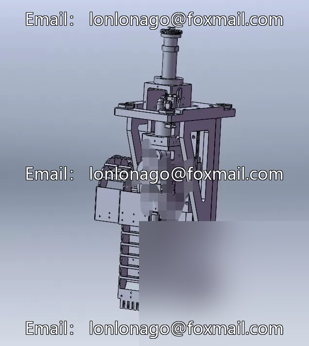
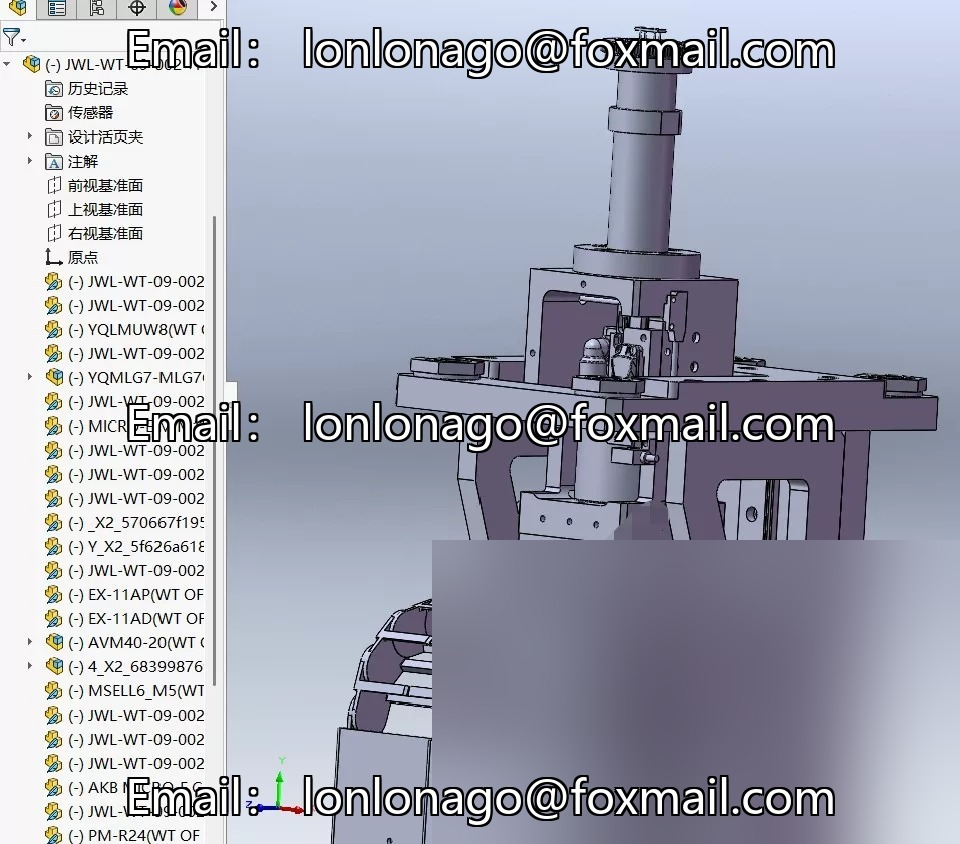

# Thin-thin chip multi-segment stud 3D

## Body

Thin ultra-thin chip multi-segment top needle. Multi-segment 3D structure sw design, and has very valuable learning reference value.

The description covers ultra-thin chip multi-segment pin 3D structure, design, and learning reference value; the image marks historical records, sensors, design notebook pages, and various reference planes with coordinate information.

<!-- AI_ENRICHED -->

## Images

## Payment

Here is a pay link on Stripe ( https://buy.stripe.com/3cs8yP7sY87d0vu9AB ). Please contact me lonlonago@foxmail.com after funding $89, and I will send you a complete data files , thank you!

